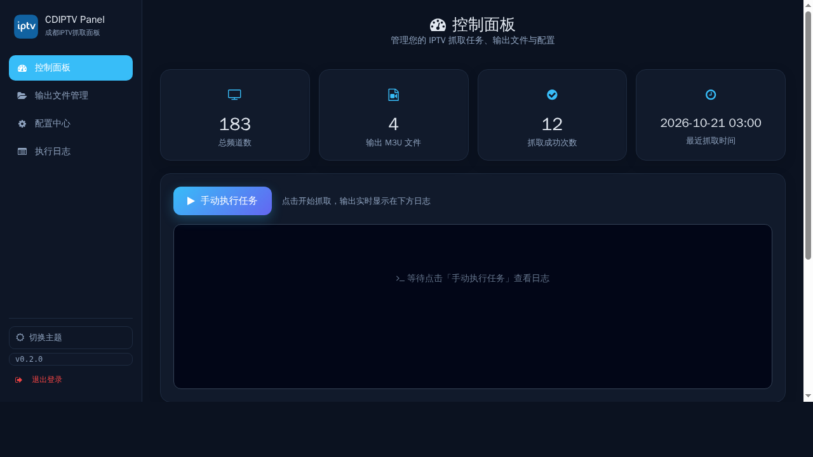
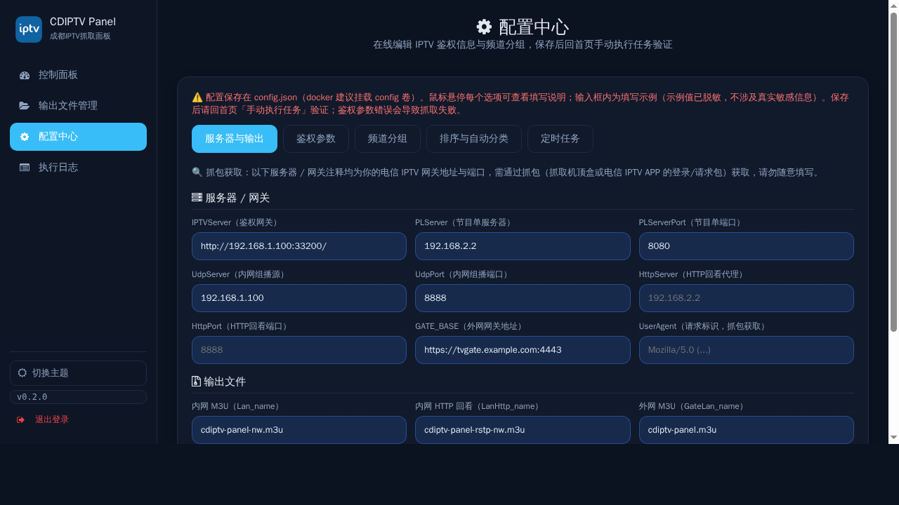
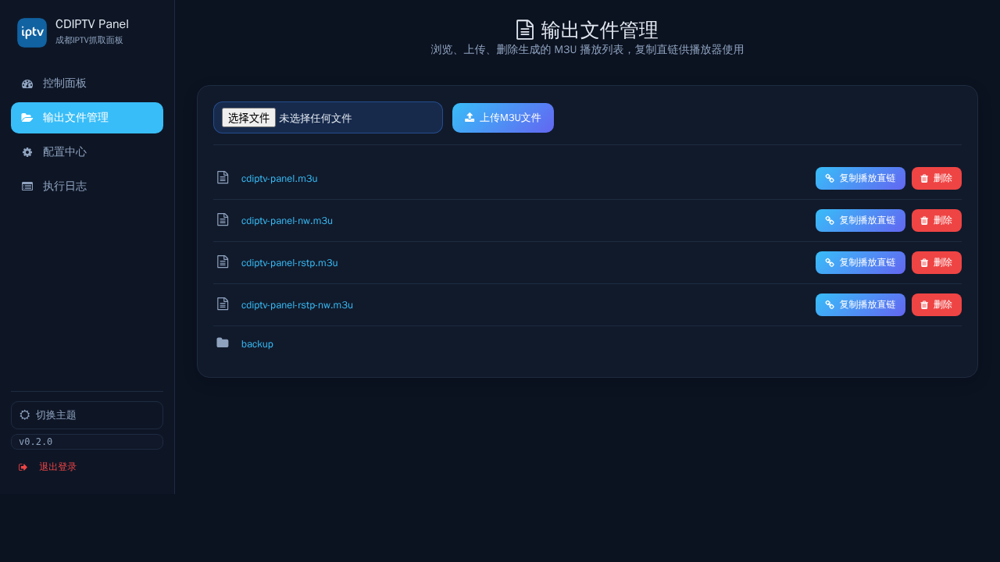
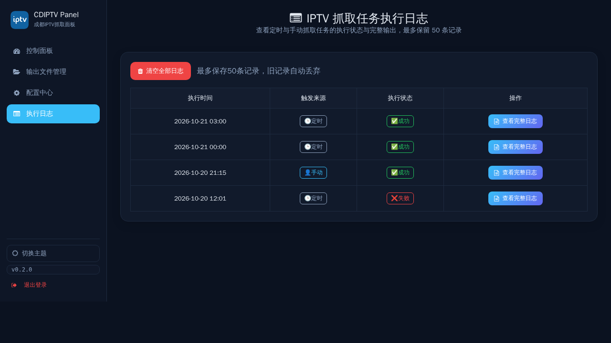
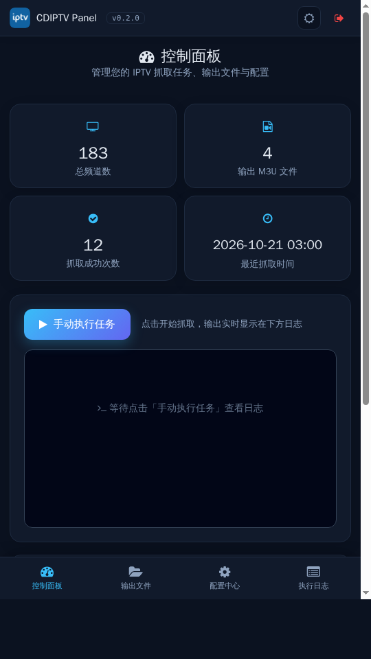
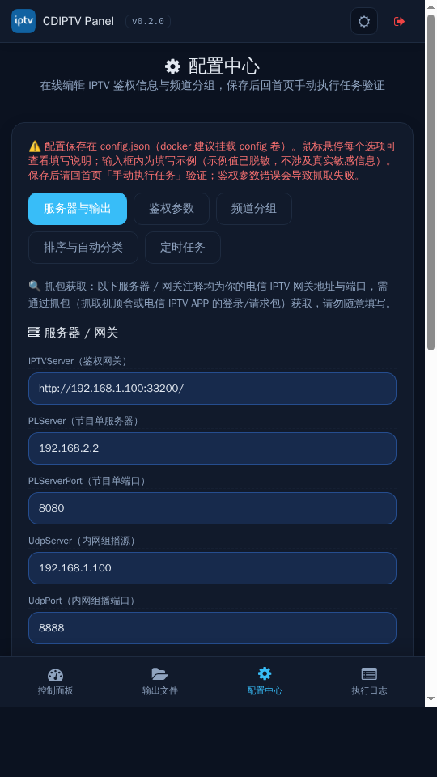
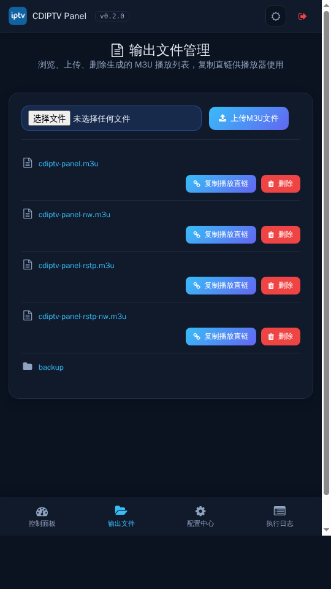
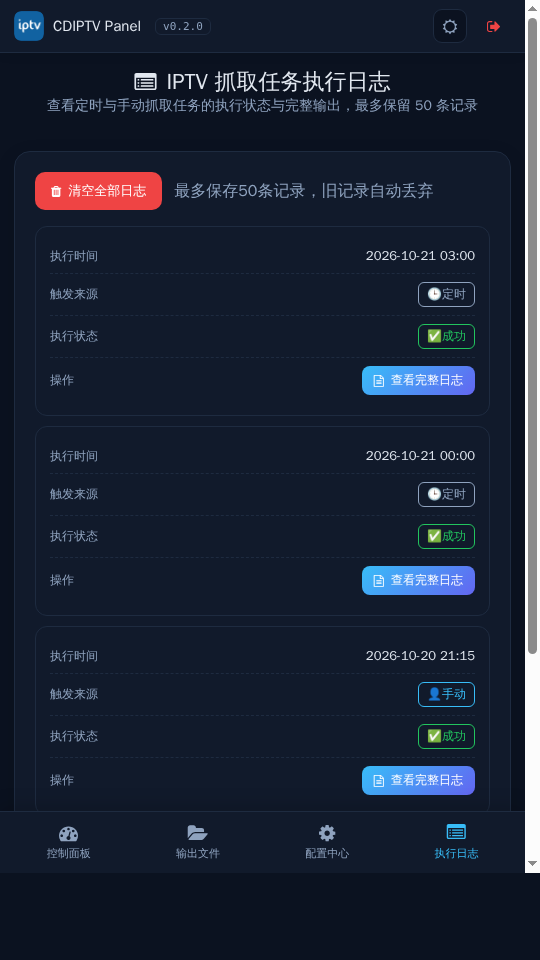

# CDIPTV Panel — 成都电信 IPTV 管理面板

> **当前版本：v0.2.0**（面板右上角标题处显示）
> **镜像**：`yanshhhh/cdiptv-panel:latest`（部署直接用 latest 标签）

模拟华为机顶盒鉴权，自动抓取成都电信 IPTV 频道列表，生成可直接导入播放器（TiviMate / Diyp / 影视仓等）的 M3U 文件，并提供 Web 管理面板在线配置、定时抓取、日志与输出管理。

## ✨ 特性

- **自动抓取**：模拟 EC6108V9U 机顶盒两步鉴权（authLoginHWCTC → ValidAuthenticationHWCTC），拉取频道列表并按规则分组
- **多份输出**：内网 UDP（`cdiptvnw.m3u`）、内网 HTTP 回看（`cdiptvrstpnw.m3u`）、外网网关 UDP（`cdiptv.m3u`）、外网 HTTP 回看（`cdiptvrstp.m3u`）
- **Web 配置中心**：`/editor` 在线编辑鉴权信息、频道分组、分组排序、定时任务，无需改代码，保存即生效
- **定时抓取**：cron 表达式调度，改动热加载，无需重启
- **频道分组**：按 央视 / 国际 / 卫视 / 四川 / 成都 / 体育 / 电影 / 少儿 / 财经 / 生活 / 教育 / 旅游 / 导视 等 20 组分门别类，并内置自动分类兜底
- **文件管理 / 日志**：`/output` 管理生成的 M3U，`/logtask` 查看任务执行日志

## 📁 目录结构

```
├── docker-compose.yml        # Docker Compose 编排
├── Dockerfile                # 镜像构建文件
├── config/                   # 脚本（打入镜像，升级自动更新）
│   ├── iptv.py               # 抓取脚本（读取 data/config.json）
│   └── webapi.py             # Web 面板（Flask, 端口 8999）
├── templates/                # 网页模板（打入镜像）
├── data/                     # ★ 数据目录（挂载为卷）：config.json / cron_config.json / task_run_log.json
└── output/                   # 生成的 M3U（挂载为卷）
```

## 📸 界面预览

**电脑端（16:9 横屏）**









**手机端（9:16 竖屏）**









## 🚀 快速开始（Docker Compose）

```bash
# 1. 创建数据与输出目录（在 compose 文件所在目录）
mkdir -p ./data ./output

# 2. 设置面板登录口令（复制 .env.example 为 .env 并修改）
cp .env.example .env
#   编辑 .env，把 PANEL_USER / PANEL_PASS 改成你自己的账号和强密码

# 3. 启动（脚本与模板已内置镜像，只需挂载 data 与 output 卷）
docker compose up -d
```

启动后浏览器访问：`http://服务器IP:8999`

> 首次运行自动生成默认配置；到「配置中心 → 鉴权参数」填入你的电信账号/机顶盒信息，再手动抓取验证。
>
> 配置保存在挂载的 `data` 卷中——**升级镜像（`docker compose pull` + `up -d`）不会丢失配置**。

## 🔧 配置中心（网页 `/editor`）

所有可配置项集中在 `data/config.json`（容器内 `/app/data`，挂载为宿主卷），网页 Tab 分区编辑：

| Tab | 配置项 | 说明 |
| --- | --- | --- |
| 服务器与输出 | `server` / `output` | 鉴权网关、内网组播、外网网关地址、输出文件名与路径 |
| 鉴权参数 | `auth` | 两步鉴权全部字段（UserID、Authenticator、STBID、mac、userToken、tempKey 等） |
| 频道分组 | `channel_map` | 每个频道的 tvg-id / tvg-name / tvg-logo / 分组，支持搜索与按分组筛选 |
| 排序与自动分类 | `group_order` / `auto_group` | 分组顺序（↑↓ 调整）、未命中时的自动分类关键词 |
| 定时任务 | `cron` | IPTV 抓取 crontab 表达式、启动即执行开关 |

保存后写入 `data/config.json`，鉴权/分组改动回首页「手动抓取」生效，定时改动自动热加载。

### config.json 字段说明

```jsonc
{
  "server": {
    "IPTVServer": "http://192.168.1.100:33200/",   // 电信鉴权网关（示例，填你的真实地址）
    "UdpServer": "192.168.1.100", "UdpPort": "8888",  // 内网组播代理（示例）
    "GATE_BASE": "https://tvgate.xxx:4443"          // 外网网关（供外部播放）
  },
  "auth": {                                         // 华为机顶盒鉴权参数
    "login": {}, "valid": {}, "channellist": {}
  },
  "channel_map": {                                  // 频道名 -> [tvg-id, tvg-name, tvg-logo, 分组]
    "CCTV-1高清": ["1", "CCTV1", "http://.../CCTV1.png", "央视"],
    ...
  },
  "auto_group": {                                   // 分组 -> [关键词]
    "少儿": ["少儿", "卡通", "动画", "动漫", ...], ...
  },
  "group_order": ["央视", "国际", ...],            // 分组显示顺序
  "cron": { "iptv_cron": "1 1 * * *", "auto_run_on_start": true }
}
```

## 🌐 面板页面

| 路由 | 功能 |
| --- | --- |
| `/` | 首页，手动抓取、查看最新日志 |
| `/editor` | 配置中心（鉴权 / 分组 / 排序 / 定时） |
| `/cron` | 定时任务配置（与配置中心同源） |
| `/output` | 输出文件管理（复制直链 / 上传 / 删除） |
| `/logtask` | 历史任务日志 |
| `/direct/m3u/...` | 免登录公开输出直链（供播放器拉取） |

## ⏰ 定时抓取

配置中心「定时任务」Tab，或 `/cron` 页设置 crontab（5 位）。示例：

- `1 1 * * *` — 每天 01:01
- `1 0,12 * * *` — 每天 00:01 与 12:01
- `5 10 */7 * *` — 每 7 天 10:05

保存自动热加载，无需重启。查看后台日志：`docker compose logs -f cdiptv-panel`

## ❓ 常见问题

- **抓取到 0 个频道 / 鉴权失败**：到「配置中心 → 鉴权参数」核对 UserID / Authenticator / STBID / userToken / tempKey 是否正确（每个电信账号/机顶盒不同）。
- **M3U 打不开**：确认 `output` 卷已挂载、`/direct/m3u/` 直链可访问；内网用 `cdiptvnw.m3u`，外网用 `cdiptv.m3u`。
- **想重置配置**：删除挂载目录下的 `data/config.json`（compose 所在目录的 `data/config.json`）重启容器，会按内置默认重新生成。

## ⚠️ 免责声明

本工具仅用于个人家庭自用，请遵守当地法律法规与运营商使用条款；鉴权参数来自用户自有账号，请勿用于非法用途。
